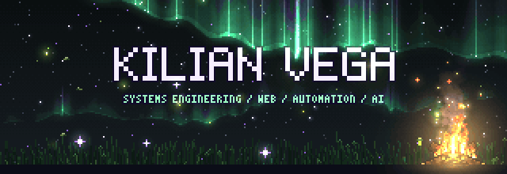
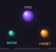
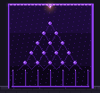

  

I study Systems Engineering at Universidad de los Llanos in Villavicencio, Colombia, and build websites and small tools for local businesses. Most of what's here started as a client job or a class assignment.

I write mostly JavaScript and Node.js, Python when a script will do, and C++ for school. I use AI coding agents every day, which in practice means a lot of reading and fixing the code they write. Spanish is my first language; I work in English too.

## Things I've built

**[whatsapp-catalog-generator](https://github.com/kilianvega-dev/whatsapp-catalog-generator)** 
Turns a config file into a print-ready PDF catalog where each product photo opens a WhatsApp chat with the product already in the message. I've delivered catalogs made with it to real furniture stores. Puppeteer renders the PDF, then a check goes through every link, image and page of the final file. Node.js, Puppeteer, sharp.

 

**[voltio-demo](https://github.com/kilianvega-dev/voltio-demo)** ([live](https://kilianvega-dev.github.io/voltio-demo/)) 
Landing page and store for a made-up tech shop. The cart shows how far you are from free shipping, and checkout covers Nequi, PSE, card, cash on delivery and ordering by WhatsApp.

 

**[colombia-utils](https://github.com/kilianvega-dev/colombia-utils)** 
Python library for Colombian holidays (Ley Emiliani included), business-day math and NIT check digits. No dependencies, with tests.

 

**[claude-delegar](https://github.com/kilianvega-dev/claude-delegar)** 
Makes Claude Code hand searches, bulk reading and well-specified coding to cheaper Haiku and Sonnet subagents on its own, so Opus only does design and review. Reading with Haiku costs about 40× less than with Opus. One command installs it on Windows, Mac or Linux.

 

**[plinko-binary-tree](https://github.com/kilianvega-dev/plinko-binary-tree)** 
A desktop Plinko game built on a complete binary tree. The ball goes left or right 50/50 at each node, and the game animates pre-, in-, post- and level-order traversals. C++17 and Qt 6, MVC with polymorphic nodes.

 

**[peaje-esp32](https://github.com/kilianvega-dev/peaje-esp32)** (in progress) 
A toll booth model for my Digital Machines course: ESP32, an HC-SR04 distance sensor and a servo for the gate, with a FastAPI backend in Docker.

 

## Contact

[My website](https://kilian-vega.kilianvega22.workers.dev) · [LinkedIn](https://www.linkedin.com/in/kilianvega-dev/) · kilianvega.dev@gmail.com

 

Pixel effects from [pixelfx](https://github.com/patch-gg/pixelfx) (MIT).
